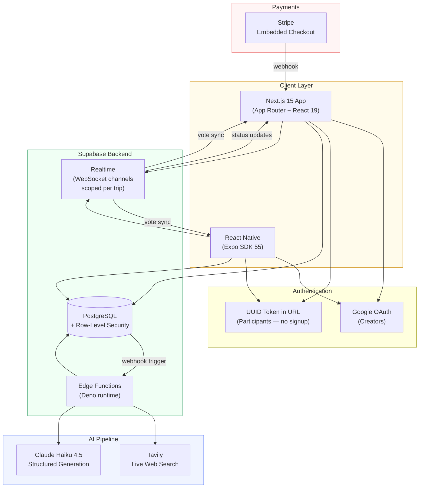
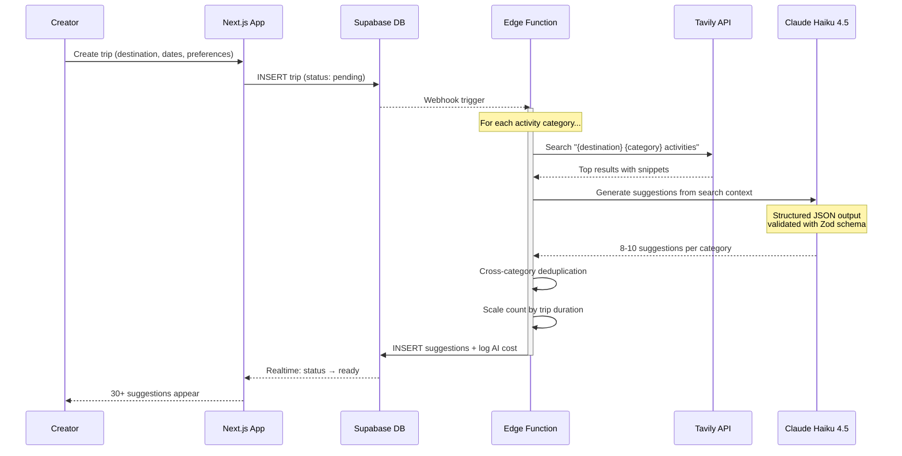
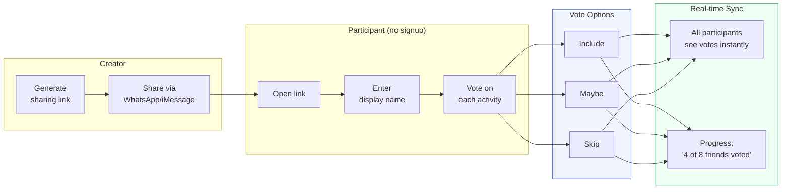
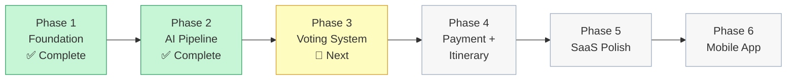

# TripCraft

**AI-powered collaborative trip planning.** Groups go from "we want to travel somewhere" to a polished, agreed-upon day-by-day itinerary — with AI doing the research and the group making the decisions together.

> This is a portfolio overview of a private project. Source code is not included.

---

## The Problem

Planning a group trip is painful. The "organizer friend" spends 10-20 hours researching destinations across blogs, Google Maps, and TikTok — then coordinates preferences over endless WhatsApp threads. Most group trips either never happen or default to whatever one person decides.

**TripCraft eliminates the research grind and the coordination chaos.**

---

## How It Works

```
 Creator                    AI Pipeline                    Group
┌─────────┐              ┌──────────────┐              ┌─────────┐
│ Sign up │              │              │              │         │
│ (Google │──── Create ──▶│  Web Search  │              │  Open   │
│  OAuth) │    Trip +     │  (Tavily)    │              │ voting  │
│         │  preferences  │      │       │              │  link   │
└─────────┘               │      ▼       │              │ (no     │
                          │  Claude AI   │── Share ────▶│ signup) │
                          │  generates   │   link       │         │
                          │  30+ ideas   │              │  Vote   │
                          │              │              │ include │
                          └──────┬───────┘              │  maybe  │
                                 │                      │  skip   │
                                 │                      └────┬────┘
                                 │                           │
                                 ▼                           │
                          ┌──────────────┐                   │
                          │  AI assembles│◀── top votes ─────┘
                          │  day-by-day  │
                          │  itinerary   │
                          └──────────────┘
```

### Step by Step

1. **Creator signs up** with Google OAuth and creates a trip — destination, dates, budget, activity preferences
2. **AI researches the destination** using live web search (not just training data) and generates 30+ structured activity suggestions
3. **Creator shares a voting link** with friends — participants need zero signup, just a display name
4. **Group votes** on each suggestion: include / maybe / skip — votes sync in real-time across all devices
5. **AI assembles the itinerary** from top-voted activities into a coherent day-by-day schedule with maps
6. **Creator pays $10** to unlock the full polished itinerary

---

## Architecture



### Why This Architecture?

| Decision | Rationale |
|----------|-----------|
| **Async Edge Functions for AI** | AI generation takes 30-90s — far beyond Vercel's serverless timeout. Supabase Edge Functions run on Deno with no timeout constraint. |
| **Asymmetric auth model** | Creators need accounts (trip ownership, payment). Participants just need a link — zero friction maximizes voting participation. |
| **Live web search, not just LLM** | Training data goes stale. Tavily fetches current restaurant hours, seasonal activities, and recent reviews per trip. |
| **Realtime per-trip channels** | Votes sync instantly across all participants. Channels are scoped to `trip_id` — never table-wide subscriptions. |
| **Pay to unlock, not pay to generate** | The itinerary is generated immediately after voting. Payment unlocks the full view. Users see value before paying. |

---

## AI Pipeline

The suggestion engine is the core differentiator. No competitor combines live web search + structured AI generation + group voting + AI assembly.



### Cost Control

Every generation logs its cost to the database. At ~$0.01-0.02 per trip (Claude Haiku 4.5 + Tavily), the system maintains **94% gross margins** on the $10 per-trip fee.

| Metric | Value |
|--------|-------|
| AI cost per trip | ~$0.01-0.02 |
| Suggestions per trip | 30-50 (scaled by trip duration) |
| Parse failure rate | < 2% across test destinations |
| Generation time | 15-30s |

---

## Voting System

The social core of the product. Designed to maximize participation rate — the single highest-risk behavioral metric.



**Design principles for engagement:**
- Zero auth wall — link opens directly to voting
- Mobile-first card UI — vote in under 5 minutes
- Live participation progress — social pressure to complete
- Real-time sync — see friends' votes appear instantly

---

## Tech Stack

| Layer | Technology |
|-------|------------|
| **Frontend** | Next.js 15, React 19, App Router, Server Components |
| **Styling** | Tailwind CSS v4 + shadcn/ui |
| **State** | Zustand (UI) + TanStack Query (server state) |
| **Database** | Supabase PostgreSQL with Row-Level Security |
| **Auth** | Supabase Auth (Google OAuth) + UUID guest tokens |
| **Realtime** | Supabase Realtime (WebSocket) |
| **AI** | Tavily (web search) + Claude Haiku 4.5 (generation) |
| **Payments** | Stripe Embedded Checkout |
| **Maps** | Leaflet + OpenStreetMap |
| **Mobile** | Expo SDK 55 + NativeWind v4.1 |
| **Monorepo** | pnpm workspaces + Turborepo |
| **Testing** | Vitest + Playwright |
| **Deployment** | Vercel (web) + Supabase (backend) |

---

## Project Structure

```
tripcraft/
├── apps/
│   ├── web/                    # Next.js 15 web application
│   └── mobile/                 # Expo React Native app
├── packages/
│   ├── types/                  # Shared TypeScript types & Zod schemas
│   └── api-client/             # Shared Supabase typed queries
├── supabase/
│   ├── functions/              # Edge Functions (AI pipeline)
│   └── migrations/             # PostgreSQL schema + RLS policies
└── scripts/                    # Dev tooling & utilities
```

---

## Development Approach

Built in 6 phases following strict architecture dependencies:



Each phase gates the next — AI pipeline must be validated before building voting UI, voting must work before wiring payments, web must be complete before mobile.

**Methodology:**
- Phased roadmap with formal requirements traceability
- Test-driven development for complex logic (AI pipeline validation)
- E2E verification with real APIs before marking phases complete
- Automated verification hierarchy: Playwright E2E > integration tests > type checking > manual testing

---

## Market Context

| Metric | Value |
|--------|-------|
| Target user | "The organizer friend" — ages 25-40, plans 2-5 group trips/year |
| Problem | 16-20+ hours of manual research per trip |
| US addressable market | ~$193M |
| Pricing | $10/trip flat fee (first trip free) |
| AI cost per trip | ~$0.01-0.02 |
| Gross margin | ~94% |
| Break-even | ~35 trips/month |

**Competitive differentiation:** No existing tool combines live web search + structured group voting + AI itinerary assembly in a single workflow.

---

## Status

**Phase 2 of 6 complete.** Foundation and AI research pipeline are built and verified end-to-end. Currently building the real-time voting system.

---

## Contact

Built by [Jannis Menzler](https://github.com/jmenzler)

*This is a portfolio project. Source code is in a private repository.*
